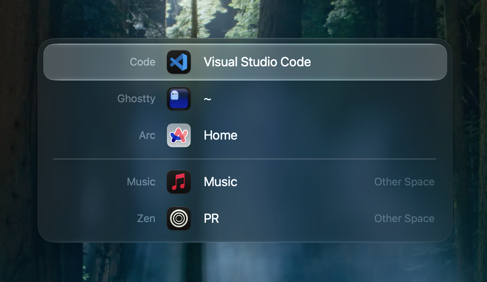
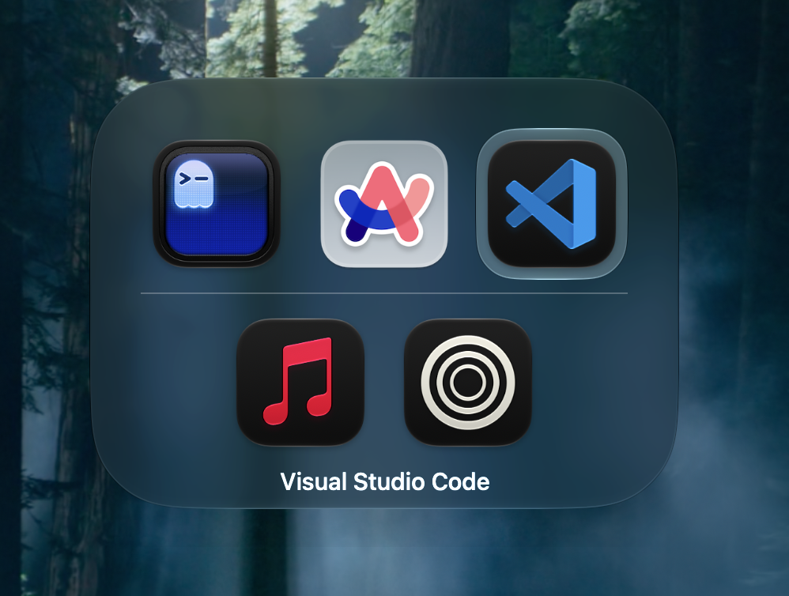

> [!CAUTION]
> This is a vibe-coded app. 
> You should not use it if you don't understand the risk!

> [!NOTE]
> I developed this for fun and personal use.
> I will also not accept contributions, issues or feature requests.

<hr>

# wicher

A tiny macOS **window switcher**: an ⌘Tab-style HUD that lists *windows*, not just apps, with type-to-search.





## Install

```sh
brew install --cask perfect-things/tap/wicher
```

Or grab the `.dmg` from [Releases](https://github.com/perfect-things/wicher/releases).
Wicher is self-signed, not notarized: the first launch of a downloaded copy needs
**System Settings → Privacy & Security → Open Anyway** (Homebrew installs skip this).
Apple Silicon, macOS 26+. Needs only **Accessibility** access (no Screen Recording).

## Usage

- **⌥Tab** opens the switcher; hold ⌥ and tap Tab to cycle, release ⌥ to switch.
  **⇧⌥Tab** cycles backward, **Esc** cancels. Arrow keys, scroll and the mouse work too.
- **Type** to fuzzy-search window titles and app names; **Esc** clears the search.
- **⌥\`** shows only the current app's windows.
- Add more switchers, each with its own shortcut and filters, in **Settings**
  (menu-bar icon, or ⌘, while the switcher is open). Any chord can be recorded,
  including ⌘Tab — it replaces the system shortcut while wicher runs.
- Each switcher shows a **List** of windows or a row of **Icons**, like ⌘Tab; each
  layout has its own sizes in **Settings → Appearance**.
- **Appearance**: Glass, Clear glass, Blurred or Solid for the background and the
  selection highlight, each with its own tint for Light and Dark mode.

## Build

```sh
scripts/build.sh    # produces Wicher.app
swift test          # unit tests
open Wicher.app
```

Or use the `justfile` (`just` lists the tasks). Run
`scripts/make-signing-identity.sh` once so the Accessibility grant survives
rebuilds; otherwise the app is ad-hoc signed and macOS re-asks each time.
